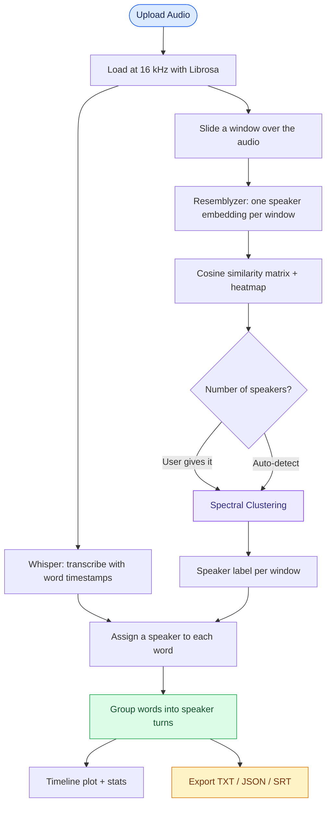
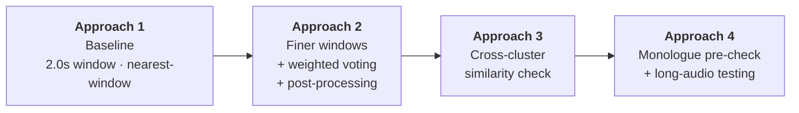

# 🎙️ LLM-Based Transcribing

### Speech Transcription + Speaker Diarization: an experimental playground

Converting audio into **speaker-labelled transcripts** (*who said what, and when*) using **OpenAI Whisper** for transcription and **Resemblyzer** speaker embeddings for diarization, then iterating on the approach to make it more robust.

This repository holds two Google Colab notebooks that represent **four successive approaches**. Each one is built to fix a weakness observed in the one before it.

| Notebook | What it contains |
|---|---|
| [`Audio_Diarization.ipynb`](./Audio_Diarization.ipynb) | **Approach 1:** baseline sliding-window pipeline, fully documented step by step |
| [`Final_window_diarize.ipynb`](./Final_window_diarize.ipynb) | **Approaches 2 to 4:** the iterative refinements (finer windows, voting, post-processing, monologue detection), each run and tested on different audio |

---

## 📌 The Problem

| Task | Meaning |
|---|---|
| **Transcription (ASR)** | Convert speech to text, with word-level timestamps |
| **Speaker diarization** | Work out *who spoke when* |
| **Alignment** | Attach a speaker label to every transcribed word |

Whisper tells us **what** was said and **when**, but not **who** said it. Resemblyzer tells us **who** is speaking in a slice of audio, but not what was said. The core job here is to **fuse the two**.

---

## 🧠 Core Pipeline (shared by all approaches)



**Stack:** Whisper `base` · Resemblyzer · scikit-learn (Spectral Clustering) · Librosa · NumPy/SciPy · Matplotlib/Seaborn · Google Colab (tested on a Tesla T4 GPU)

---

## 🔬 The Approaches



### Approach 1: Baseline Sliding Window
📓 `Audio_Diarization.ipynb`

| Setting | Value |
|---|---|
| Window / step | **2.0 s / 0.5 s** |
| Speaker count | Eigenvalue-gap heuristic (or user-specified) |
| Word → speaker | **Nearest window centre** (a single window decides) |

**How it works:** slide a 2 s window across the audio, embed each window, build a cosine-similarity matrix, spectral-cluster the windows, then give every word the label of the window whose centre is closest to the word's midpoint.

**Result (27.3 s, 2-speaker clip):** 51 windows → 2 speakers (36 / 15 windows) → 73 words split 53 / 20 between speakers.

**Why it needed improving:**
- A 2 s window is long compared with a one- or two-word reply, so short interjections (e.g. *"Yeah,"*) get blurred into the neighbouring speaker's window.
- Using **one** window per word makes labels flip on boundary words (the same phrase *"to… How"* ended up labelled to different speakers at 13.9 s and 15.2 s).
- Output was kept at **word level** (73 segments for 73 words) rather than clean speaker turns.
- The eigenvalue heuristic always returns *at least 2* speakers, so a one-person recording would be wrongly split.

---

### Approach 2: Finer Windows + Weighted Voting + Post-Processing
📓 `Final_window_diarize.ipynb`: *"Reduced step and window size to capture edge cases"*

| Change | From → To | Why |
|---|---|---|
| Window size | 2.0 s → **1.5 s** | Better capture of short utterances |
| Step | 0.5 s → **0.25 s** | Twice the temporal resolution (≈ 2× the windows) |
| Word assignment | Nearest window → **inverse-distance weighted vote of the 3 nearest windows** (`VOTING_WINDOW = 3`) | One noisy window can no longer flip a word |
| Post-processing | none → **merge isolated segments < 0.5 s** that are sandwiched between the same speaker, then re-merge adjacent same-speaker segments | Removes flicker and gives real speaker turns |
| Environment | → pins `numpy==2.0.2` | Fixes a NumPy compatibility issue in Colab |

**Results**

| Audio | Windows | Speakers | Words (S0 / S1) | Short segments fixed | Final turns |
|---|---|---|---|---|---|
| 27.3 s clip (same as Approach 1) | 104 (vs 51) | 2 | 54 / 19 | 0 | **4** (vs 73 word-level entries) |
| 124.7 s clip | 493 | 2 | 75 / 65 | 8 | **33** (from 140 word-level entries) |

**Advancement:** on the same 27 s clip the speaker split is essentially unchanged (one word differs), but the output is now **4 clean speaker turns instead of 73 word-level fragments**. On the longer clip the post-processing step does real work: 8 isolated flickers were absorbed.

---

### Approach 3: Cross-Cluster Similarity Check (self-validating speaker count)
📓 `Final_window_diarize.ipynb`: *"New"*

**Problem found:** spectral clustering will happily split *one* person into two clusters (a monologue with varied pitch, loudness or noise) because the eigengap rule never returns fewer than 2.

**Fix:** after proposing 2 speakers, sample windows from each cluster and measure their **average cross-cluster cosine similarity**. If it is **> 0.70**, the "two speakers" are almost certainly the same person, so collapse to **1 speaker** (with a dedicated single-speaker path that skips clustering).

**Result (27.3 s clip):** cross-speaker similarity **0.566** → *"Confirmed 2 distinct speakers"*; output identical to Approach 2 (104 windows, 76 / 28 split, 4 turns), so the check **does not damage a genuine conversation**.

**Advancement:** the speaker count is now *verified* instead of blindly trusted.

---

### Approach 4: Monologue Pre-Check + Long-Audio Testing
📓 `Final_window_diarize.ipynb`: *"Check before clustering"* → *"Testing with 3 mins audio"*

**Added:** a pre-clustering diversity check that samples 50 embeddings and computes pairwise cosine distance. A monologue is flagged when **mean distance < 0.15 and std < 0.08**. The Approach 3 cross-similarity rule stays in place as a second line of defence.

**Results across very different audio**

| Audio | Mean voice distance | Cross-cluster similarity | Decision | Output |
|---|---|---|---|---|
| 33.0 s, single speaker | 0.209 (std 0.076) | **0.744** (> 0.70) | **1 speaker** (pre-check did not fire; the cross-similarity guard caught it) | 127 windows → 1 turn, 92 words |
| 49 min (2,957 s) recording | 0.361 | 0.552 | **2 speakers** | 11,824 windows, 8,739 words → 325 turns (59.7 % / 40.3 % of windows), 52 flickers fixed; words 5,113 / 3,626 |
| 3 min 21 s (201 s) clip, auto | 0.413 | 0.526 | **2 speakers** | 799 windows, 692 words → 16 turns, 4 flickers fixed; words 241 / 451 |
| Same 201 s clip, **forced 5 speakers** | 0.420 | n/a (user override) | 5 speakers | 38 turns; words 67 / 150 / 247 / 16 / 212 |

**Advancements and takeaways**
- ✅ **Monologue handling:** the single-speaker clip is no longer split into two fake speakers.
- ✅ **Scales:** the same pipeline processed ~49 minutes of audio (8,739 words) end to end.
- ✅ **Consistent behaviour:** 2-speaker audio produces 2 speakers across clips of 27 s, 2 min, 3 min and 49 min.
- ⚠️ **Sensitivity to the speaker count:** forcing 5 speakers on the 3-minute clip fragments it from 16 turns into 38, including a tiny cluster of only 16 words. This shows why the auto-detect + validation logic matters, and that the manual override should only be used when the true count is known.

---

## 📈 Summary of Advancements

| | Approach 1 | Approach 2 | Approach 3 | Approach 4 |
|---|---|---|---|---|
| Window / step | 2.0 / 0.5 s | 1.5 / 0.25 s | 1.5 / 0.25 s | 1.5 / 0.25 s |
| Word → speaker | Nearest window | Weighted vote (3 windows) | Weighted vote | Weighted vote |
| Flicker clean-up | ❌ | ✅ merges < 0.5 s islands | ✅ | ✅ |
| Output granularity | Word-level | Speaker turns | Speaker turns | Speaker turns |
| Handles 1 speaker | ❌ | ❌ | ✅ cross-similarity | ✅ + monologue pre-check |
| Tested on | 27 s | 27 s, 2 min | 27 s | 33 s, 3 min, 49 min |

> **Note on evaluation:** the results above are *structural* observations from the notebook runs (windows, speaker counts, turn counts, distribution of words). No reference transcripts or speaker annotations were used, so **WER and DER have not been measured yet**. They are listed under future work.

---

## 📊 Outputs

Every run produces:

| File | Description |
|---|---|
| `transcript_with_speakers.txt` | Readable speaker-wise transcript |
| `transcript_detailed.json` | Language, speaker segments, speaker count |
| `transcript.srt` | Subtitle file with speaker labels and timestamps |

Plus a **similarity heatmap**, a **speaker timeline plot** and **per-speaker statistics** (segments, speaking time, words).

Example (format illustration):

```text
[SPEAKER_01]
[0.0s] So, Aaron, in your email you said you wanted to talk about the exam.

[SPEAKER_00]
[4.7s] Yeah, um, I've just never taken a class with so many different readings.
```

---

## 🛠️ Getting Started

No installation is needed on your machine. Everything runs in **Google Colab**.

1. Go to [colab.research.google.com](https://colab.research.google.com) → **File → Upload notebook**.
2. Upload either notebook from this repo (`Audio_Diarization.ipynb` for the baseline, `Final_window_diarize.ipynb` for the improved pipeline).
3. Set the runtime to **GPU** (*Runtime → Change runtime type → T4 GPU*) for faster Whisper and embedding extraction.
4. Run the cells top to bottom. The first cell installs dependencies (`openai-whisper`, `resemblyzer`, `scikit-learn`, `librosa`, `pydub`, `matplotlib`, `seaborn`; the improved notebook also pins `numpy==2.0.2`). This takes ~2 to 3 minutes.
5. When prompted, **upload an audio file**.
6. When asked *"How many speakers?"*, type a number, or press **Enter** to auto-detect.
7. Download the generated **TXT / JSON / SRT** files.

**Tunable parameters** (top of each notebook)

```python
WINDOW_SIZE       = 1.5   # seconds per embedding window
WINDOW_STEP       = 0.25  # stride between windows
MIN_SEGMENT_LENGTH = 0.5  # seconds
VOTING_WINDOW     = 3     # nearby windows used for voting (improved notebook)
```

---

## ⚠️ Known Limitations

- Audio **shorter than the window size** produces no windows. Handling for this case is noted in the notebook but not implemented yet.
- **Overlapping speech** is assigned to a single speaker.
- Speaker count is still a **heuristic**; thresholds (0.70 cross-similarity, 0.15 / 0.08 monologue) were tuned on a handful of clips and may need adjusting for other audio.
- Pairwise cosine statistics use a random sample (no fixed seed), so borderline cases can vary slightly between runs.
- Whisper `base` is fast but less accurate on noisy audio, accents and non-English speech.
- Clustering cost grows quickly with audio length (the 49-minute run built a ~11.8 k × 11.8 k similarity matrix).

---

## 🚀 Future Work

- [ ] Measure **WER** (transcription) and **DER** (diarization) on annotated audio
- [ ] Handle audio shorter than one window
- [ ] Try larger Whisper models and alternative ASR models
- [ ] LLM-based transcript refinement (punctuation, correction, speaker naming)
- [ ] Alternative speaker-embedding models and diarization frameworks
- [ ] Better alignment using word boundaries rather than window centres
- [ ] Overlapping-speech handling
- [ ] Fix the random seed for reproducible speaker-count decisions

---

## 🌱 Philosophy

Each notebook is a step in a learning loop: **build → observe a failure → understand why → fix it → test on harder audio.**

**Explore. Experiment. Compare. Improve.**
