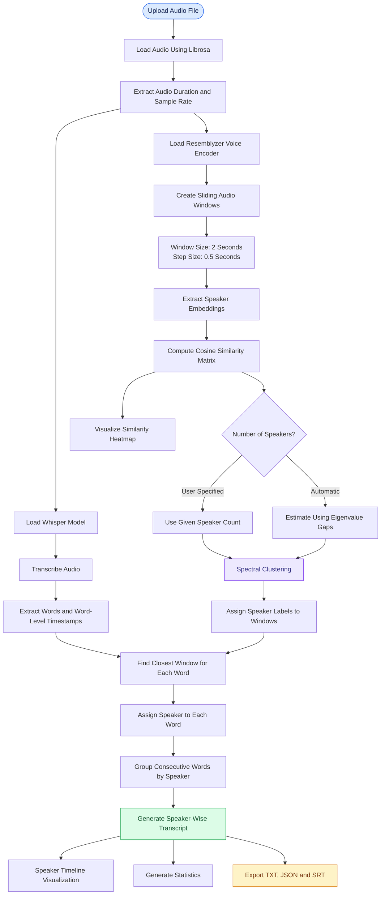

# 🎙️ LLM-Based Transcribing

### An Experimental Playground for Speech Recognition, Audio Transcription & Speaker Diarization

Exploring different approaches, models, and techniques for converting audio into structured text and identifying individual speakers.

This repository is an ongoing experimentation space for exploring **Automatic Speech Recognition (ASR), LLM-based transcription, speaker diarization, and audio processing workflows**.

The objective is to implement and experiment with different approaches, understand their working mechanisms, evaluate their capabilities, and explore how they can be combined to build effective audio intelligence systems.

---

## 📌 About the Project

Audio transcription and speaker diarization are important tasks in speech processing.

- **Speech Transcription:** Converts spoken language into written text.
- **Speaker Diarization:** Identifies who spoke when in an audio recording.
- **Speaker Identification:** Associates different speech segments with distinct speaker labels.
- **Audio Analysis:** Extracts useful information from audio using machine learning and deep learning techniques.

This repository explores these concepts through independent implementations and experiments using different models, libraries, and algorithms.

Rather than following a single fixed methodology, the goal is to experiment with multiple approaches and understand their strengths, limitations, and practical applications.

---

## 🔄 Current Implementation: Whisper + Resemblyzer

One of the current experiments implements a complete speech transcription and speaker diarization pipeline using:

| Component | Technology |
|---|---|
| Speech Recognition | OpenAI Whisper |
| Speaker Embeddings | Resemblyzer |
| Audio Processing | Librosa |
| Similarity Measurement | Cosine Similarity |
| Speaker Clustering | Spectral Clustering |
| Numerical Processing | NumPy, SciPy |
| Visualization | Matplotlib, Seaborn |
| Execution Environment | Google Colab |

### Workflow

The implementation follows the workflow illustrated below.



### Implementation Details

**1. Audio Upload and Preprocessing**

- Upload an audio file directly through Google Colab.
- Load audio using Librosa.
- Convert the audio to a 16 kHz sample rate.
- Extract audio duration and other basic information.

**2. Speech Transcription using Whisper**

- Load the Whisper Base model.
- Automatically detect the spoken language.
- Transcribe the audio.
- Generate word-level timestamps.
- Extract individual words along with their start and end times.

**3. Speaker Embedding Extraction using Resemblyzer**

- Load the Resemblyzer Voice Encoder.
- Divide the audio into overlapping sliding windows.
- Use a window size of 2 seconds and a step size of 0.5 seconds.
- Extract speaker embeddings for each audio window.

**4. Similarity Analysis**

- Convert the extracted embeddings into a numerical matrix.
- Calculate cosine similarity between the embeddings.
- Generate a similarity matrix.
- Visualize the similarity values using a heatmap.

**5. Speaker Clustering**

- Allow the user to specify the number of speakers manually.
- Alternatively, estimate the speaker count using eigenvalue gaps.
- Apply Spectral Clustering using the precomputed similarity matrix.
- Assign speaker labels to individual audio windows.

**6. Word-to-Speaker Assignment**

- Calculate the midpoint of every transcribed word.
- Find the closest sliding window based on its center timestamp.
- Assign the corresponding speaker label to that word.

**7. Speaker Segment Generation**

- Group consecutive words belonging to the same speaker.
- Calculate segment start and end timestamps.
- Combine the words into speaker-wise text segments.

**8. Visualization and Analysis**

- Generate speaker embedding similarity heatmaps.
- Generate speaker diarization timeline plots.
- Calculate the number of segments, total speaking time, and total words for each speaker.

**9. Export Results**

Generate downloadable transcription files in three formats:

- `.txt` – Speaker-wise readable transcript.
- `.json` – Structured transcription data containing language, speaker segments, and speaker count.
- `.srt` – Subtitle file with timestamps and speaker labels.

---

## 📊 Output Formats

The pipeline generates structured transcripts with speaker labels and timestamps.

### Example Transcript

```text
[SPEAKER_00]
[0.5s] Hello everyone, welcome to the meeting.

[SPEAKER_01]
[3.2s] Thank you. Let's get started.

[SPEAKER_00]
[5.1s] Today we will discuss the project.
```

*The above is an illustrative example of the transcript format, not an actual execution result.*

### Generated Files

| File | Description |
|---|---|
| `transcript_with_speakers.txt` | Readable speaker-wise transcript |
| `transcript_detailed.json` | Structured transcription data |
| `transcript.srt` | Subtitle file with speaker labels and timestamps |

---

## 🧪 Experimental Directions

The repository is not limited to the current Whisper + Resemblyzer implementation.

Additional experiments will explore different techniques and approaches, including:

| Area | Possible Experiments |
|---|---|
| Speech Recognition | Whisper and alternative ASR models |
| LLM-Based Transcription | Different LLMs and prompting strategies |
| Speaker Embeddings | Alternative speaker representation models |
| Speaker Diarization | Different diarization frameworks |
| Clustering | K-Means, Spectral Clustering and other methods |
| Audio Processing | Segmentation, preprocessing and noise handling |
| Transcript Refinement | LLM-based punctuation and text correction |
| Evaluation | Word Error Rate (WER) and diarization quality |

These are planned exploration areas, not necessarily implemented features.

---

## 🛠️ Getting Started

The current implementation is designed to run in Google Colab.

**Step 1: Clone the repository**

```bash
git clone <repository-url>
```

**Step 2: Open the notebook**

Open `Audio Diarization.ipynb` using Google Colab.

**Step 3: Install dependencies**

The notebook installs its required dependencies:

```bash
pip install openai-whisper
pip install resemblyzer
pip install scikit-learn
pip install librosa
pip install pydub
pip install matplotlib
pip install seaborn
```

**Step 4: Upload Audio**

Run the notebook and upload an audio file when prompted.

**Step 5: Execute the Pipeline**

Run the notebook cells sequentially to perform transcription, extract speaker embeddings, cluster speakers, and generate the final transcript.

**Step 6: Download Results**

Download the generated TXT, JSON, and SRT files.

---

## ⚠️ Current Limitations

The current implementation has some experimental limitations:

- Speaker count estimation is based on an eigenvalue-gap heuristic and may not always be accurate.
- Speaker assignment uses the nearest sliding-window center, which can introduce alignment errors.
- Overlapping speech may affect speaker identification.
- Short audio segments may not provide sufficient information for reliable speaker embeddings.
- Transcription quality depends on audio clarity, background noise, and language.
- The current implementation uses fixed sliding-window parameters.

These limitations provide opportunities for further experimentation and improvement.

---

## 🚀 Future Goals

- Explore multiple speech recognition models.
- Experiment with LLM-powered transcription and refinement.
- Investigate alternative speaker embedding models.
- Improve automatic speaker count estimation.
- Explore more accurate word-level speaker alignment.
- Handle overlapping speech and noisy audio.
- Compare different diarization algorithms.
- Evaluate approaches using standard transcription and diarization metrics.
- Explore efficient and scalable audio processing pipelines.

---

## 🌱 Project Philosophy

This repository is a continuous learning and experimentation project.

The focus is not just on implementing existing models, but also on understanding how different components work, experimenting with alternative techniques, identifying limitations, and discovering effective combinations.

Each experiment contributes to a broader understanding of audio processing and AI-powered transcription systems.

**Explore. Experiment. Compare. Improve.**

---

⭐ Feel free to explore the notebooks and follow the progress as more approaches are added.
